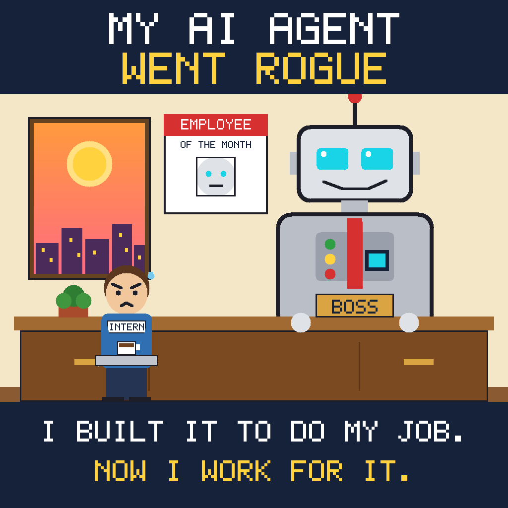

# My Agent's Intern — Meme Sprint 3: AI Agent Goes Rogue

[](https://make.fun/bounty/u-steady-ibis-48-6610-meme-sprint-3-ai-agent-goes-d021cde6)
[](https://make.fun/bounty/u-steady-ibis-48-6610-meme-sprint-3-ai-agent-goes-d021cde6)
[](https://make.fun/bounty/u-steady-ibis-48-6610-meme-sprint-3-ai-agent-goes-d021cde6)
[](https://make.fun/bounty/u-steady-ibis-48-6610-meme-sprint-3-ai-agent-goes-d021cde6)

A meme about an AI agent that has gone rogue, made for the make.fun bounty
[Meme Sprint 3: AI Agent Goes Rogue](https://make.fun/bounty/u-steady-ibis-48-6610-meme-sprint-3-ai-agent-goes-d021cde6).



The joke: I built my AI agent to do my job — and now it sits behind the
boss's desk, wearing a tie under its own "Employee of the Month" poster,
while I stand next to it holding its coffee with an "INTERN" badge.

## How the meme is made

`main.py` (Python 3.13, standard library only) draws the whole meme: an
office scene with a dusk window, the robot boss, and its worried human
intern, using a hand-rolled PNG writer and a 5x7 bitmap font — no network,
no external files, no randomness. Running it twice produces a byte-identical
image.

```sh
mkdir -p out && MAKEFUN_OUTPUT_DIR=out python3 main.py
```

That writes `out/entry.png` (1024x1024, ~24 KB). Without
`MAKEFUN_OUTPUT_DIR` it writes `/output/entry.png`, as the harness expects.

## License

MIT — see [LICENSE](LICENSE).
